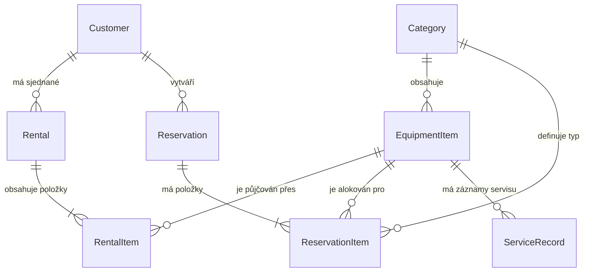

# Hory a voda – Informační systém pro půjčovnu vybavení

Semestrální projekt pro předmět **Pokročilé programování (PPRO)**, FIM UHK (ZS 2026/2027).  
Zpracováno na základě oficiálního zadání: **Varianta D: Půjčovna vybavení**.

---

## 1. Kontext a výchozí situace

### 1.1 Klient
* **Organizace / Firma:** Hory a voda
* **Kontaktní osoba / Majitel:** Martin Řehák
* **Zaměření:** Sezónní půjčovna sportovního vybavení (zima: lyže, snowboardy, boty, hole; léto: lodě, pádla, vesty).
* **Charakter provozu:** Velmi krátká a intenzivní sezóna, o víkendech se u pultu tvoří fronty, personál je v časovém presu.

### 1.2 Výchozí stav (Jak to mají dnes)
* **Evidence vybavení:** Papírový sešit, inventární čísla napsaná lihovým fixem přímo na vybavení.
* **Příjem rezervací:** Rezervace se přijímají po telefonu a zapisují se na papírové lístečky připíchnuté na nástěnce nad pultem.
* **Problémy v sezóně:** Často se stane, že je jeden pár lyží slíben dvěma lidem současně.
* **Krizové řešení na místě:** *„V sobotu ráno nemám čas to řešit, tak vždycky někomu dám něco jiného a slevím.“* – absence přehledu vede k finančním ztrátám a chaosu ve skladu.

---

## 2. Analýza požadavků

Dokument zadání člení požadavky do čtyř kategorií podle jejich závaznosti a dopadu na návrh systému:

### 2.1 Funkční požadavky (Co klient chce – musí být implementováno)
1. **Evidence jednotlivých kusů vybavení:**
   * Každý kus má unikátní inventární číslo, kategorii, velikost (délku lyží, velikost bot apod.), rok pořízení a stav opotřebení.
   * Kusy jsou evidovány jako samostatné unikátní fyzické entity (dva totožné páry lyží téhož modelu a délky představují dva samostatné záznamy v databázi).
2. **Kategorie vybavení a vazba na ceny:**
   * Číselník kategorií: lyže, snowboardy, boty, hole, lodě, vesty atd.
   * Cenotvorba se odvíjí od kategorie vybavení a délky výpůjčky.
3. **Evidence zákazníků:**
   * Jméno, příjmení, telefonní číslo, číslo dokladu totožnosti (OP / pas), výše složené kauce.
4. **Správa výpůjček:**
   * Jedna výpůjčka může obsahovat několik různých kusů vybavení (např. kompletní lyžařský set pro rodinu).
   * Výpůjčka má definované datum a čas `od` a `do`.
   * Tentýž kus vybavení se v průběhu sezóny půjčuje opakovaně.
5. **Dopředné rezervace:**
   * Možnost telefonické rezervace předem (např. v úterý rezervace na víkend).
6. **Flexibilní a částečné vracení:**
   * Umožnit vrácení výpůjčky po částech (např. zákazník vrátí lyže v 15:00 a boty si nechá až do 19:00).
7. **Správa servisu a údržby:**
   * Možnost odeslat konkrétní kus vybavení do servisu – po dobu servisu je kus blokován a nelze jej půjčit ani rezervovat.
   * Přehled: co je aktuálně v servisu a jak dlouho oprava trvá.
8. **Cenové tarify a víkendové sazby:**
   * Výpočet ceny podle kategorie a počtu dní.
   * Speciální víkendová sazba: víkend se počítá jako 2 dny, ale zápůjčka začíná již v pátek odpoledne.
9. **Přehledy a reporting pro majitele:**
   * Okamžitý přehled: co je právě půjčené venku.
   * Přehled prodlení: co mělo být vráceno a nebylo (včetně výpočtu penále).
   * Vytíženost vybavení: jak často se který kus půjčuje (podklad pro rozhodování o nákupu nového vybavení na další sezónu).

---

### 2.2 Obchodní pravidla (Na čem klient trvá – systém vynutí bez výjimky)
* **Zákaz kolize výpůjček a rezervací:** Jeden konkrétní kus nesmí být ve dvou výpůjčkách nebo rezervacích, které se časově překrývají.
* **Blokace servisem:** Kus se stavem „v servisu“ nesmí jít půjčit ani zarezervovat na dobu servisu.
* **Penále za zpoždění:** Za pozdní vrácení po sjednaném termínu se striktně počítá smluvní penále za každý započatý den prodlení.
* **Zachování historie kusu:** Historie výpůjček konkrétního kusu se **nikdy nemaže** – slouží k řešení reklamací a k vyhodnocení opotřebení při obměně fondu.

---

### 2.3 Přání a výhled do budoucna (Co klient prohodil mimochodem)
* **Pultový dashboard (Sobotní ranní špička):** Jedna přehledná obrazovka pro obsluhu u pultu, kde je okamžitě vidět, co je právě volné k výdeji bez nutnosti složitého proklikávání.
* **Kauce v hotovosti:** Kauce se často skládá v hotovosti u pultu – systém má evidovat výši a stav vratky, ale nemusí řešit bankovní platební bránu.
* **Ruční slevy majitele:** Možnost administrátora/obsluhy aplikovat ruční položkovou nebo celkovou slevu.
* **Tisk smluv:** Možnost vygenerovat jednoduchou tiskovou sestavu / smlouvu o výpůjčce k podpisu zákazníkem.

---

### 2.4 Povinné technické minimum (Dle pravidel předmětu PPRO)
* **Architektura:** Striktně třívrstvá architektura se závislostmi orientovanými pouze jedním směrem (Prezentační -> Aplikační/Doménová -> Datová/Infrastrukturní).
* **Databáze:** Relační databáze (PostgreSQL) běžící v Docker kontejneru.
* **Migrace:** Verzované migrace schématu spravované migračním nástrojem.
* **Doménový model:** Minimálně 5 entit a alespoň jedna vazba M:N.
* **Testování:** Sada integračních a jednotkových testů pokrývajících klíčová obchodní pravidla (detekce kolizí, výpočet penále, servisy).
* **Deployment & běh:** Spustitelné reprodukovatelně pomocí:
  ```bash
  docker compose up
  ```
* **Bezpečnost dat:** Syntetická testovací data (žádné reálné osobní údaje, žádné přihlašovací klíče v repozitáři).
* **Kritické místo návrhu (Kde se návrh láme):** **Rezervace konkrétního kusu proti rezervaci typu/kapacity** a návazný stavový mechanismus částečného vracení a expirace.

---

## 3. Doménový model a architektura

### 3.1 Seznam doménových entit

| Entita | Popis | Klíčové atributy |
| :--- | :--- | :--- |
| **`Category`** | Kategorie vybavení | `id`, `name`, `code`, `base_daily_rate`, `weekend_rate` |
| **`EquipmentItem`** | Konkrétní fyzický kus | `id`, `category_id`, `inventory_number` (unikátní), `model_name`, `size`, `year_acquired`, `wear_condition`, `status` (*AVAILABLE*, *RENTED*, *IN_SERVICE*, *RETIRED*) |
| **`Customer`** | Zákazník | `id`, `first_name`, `last_name`, `phone`, `id_document_number`, `created_at` |
| **`Rental`** | Výpůjčka | `id`, `customer_id`, `created_at`, `planned_start`, `planned_end`, `deposit_amount`, `discount_amount`, `status` (*ACTIVE*, *RETURNED_PARTIAL*, *COMPLETED*, *OVERDUE*) |
| **`RentalItem`** (M:N) | Položka výpůjčky (konkrétní kus ve výpůjčce) | `id`, `rental_id`, `equipment_item_id`, `unit_daily_price`, `actual_returned_at`, `late_fee`, `status` (*RENTED*, *RETURNED*, *DAMAGED*), `damage_notes` |
| **`Reservation`** | Rezervace na termín | `id`, `customer_id`, `created_at`, `reserved_from`, `reserved_to`, `expires_at`, `status` (*PENDING*, *CONFIRMED*, *FULFILLED*, *EXPIRED*, *CANCELLED*) |
| **`ReservationItem`** | Požadavek v rezervaci (typ/velikost vs. konkrétní kus) | `id`, `reservation_id`, `category_id`, `size_specification`, `equipment_item_id` (volitelně konkrétní kus), `allocated_at` |
| **`ServiceRecord`** | Servisní odstávka / oprava | `id`, `equipment_item_id`, `started_at`, `finished_at`, `reason`, `cost`, `performed_by` |

### 3.2 Vztahy mezi entitami (ER Diagram)



---

## 4. Sekce Rozhodnutí (Architektonický a procesní deník)

> Tato sekce slouží jako oficiální záznam architektonických, procesních a analytických rozhodnutí. Každý otevřený bod obsahuje formulaci problému, přijaté řešení a jednoznačné odůvodnění.

### 4.1 Otevřené body ze zadání klienta

#### Rozhodnutí č. 1: Rezervace konkrétního kusu vs. rezervace typu/kapacity (Kde se návrh láme)
* **Formulace problému:** Zákazník při telefonátu požaduje např. „lyže 170 cm a boty 43“, nikoliv konkrétní inventární číslo 412. Klient nedokáže rozlišit, zda rezervovat konkrétní kus, nebo držet kapacitní kvótu v dané kategorii a velikosti.
* **Rozhodnutí:** Rezervace se standardně zakládá na **kategorii a velikostní specifikaci (typ/kapacita)**. Systém při rezervaci garantuje disponibilitu v rámci časového okna rezervací kapacitní kvóty. Přiřazení konkrétního fyzického kusu s inventárním číslem probíhá **až při fyzickém výdeji u pultu** (převod rezervace na výpůjčku). Systém volitelně umožňuje administrátorovi přiřadit konkrétní kus předem (např. pro prémiové modely či VIP zákazníky).
* **Odůvodnění:** O ranní sobotní špičce personál nemůže ztrácet čas hledáním konkrétního páru lyží ze včerejšího lístečku, pokud vedle stojí identický volný pár. Navíc přiřazení konkrétního kusu dopředu by způsobilo zbytečné blokace při zpožděném vrácení či náhlé nutnosti servisu.

#### Rozhodnutí č. 2: Časová platnost rezervace a expirace (Propadnutí)
* **Formulace problému:** Klient ví, že ranní rezervace drží „do desíti“, ale neví, co se stane v 10:05 a zda má systém zasáhnout automaticky.
* **Rozhodnutí:** Každá rezervace má definován mezní čas vyzvednutí (např. 10:00) a systémem stanovené **toleranční okno 30 minut** (do 10:30). Po uplynutí tolerančního okna systém rezervaci automaticky označí jako `EXPIRED` a uvolní kapacitní blokaci pro zákazníky stojící ve frontě. Obsluha má možnost u konkrétní rezervace jedním kliknutím prodloužit lhůtu (např. když zákazník zavolá, že stojí v koloně).
* **Odůvodnění:** Okamžité striktní smazání v 10:01 by vyvolávalo konflikty při drobném zpoždění na cestě. Naopak držení bez expirace by blokovalo vybavení v nejvytíženější části dne na úkor platících zákazníků u pultu.

#### Rozhodnutí č. 3: Evidence poškození vybavení a finanční vypořádání
* **Formulace problému:** Poškození dnes personál drží v hlavě; není dořešeno, zda se váže ke kusu, k výpůjčce, nebo ke kauci.
* **Rozhodnutí:** Poškození se zaznamenává k **položce výpůjčky (`RentalItem`) s fotodokumentací/popisem** a zároveň propisuje změnu stavu do profilu fyzického kusu (`EquipmentItem.wear_condition`). Vypočtená škoda se primárně odečítá z hotovostní či blokované kauce zákazníka u dané výpůjčky. Pokud poškození brání dalšímu bezpečnému provozu, kus se automaticky přepne do stavu `IN_SERVICE` a vytvoří se záznam v `ServiceRecord`.
* **Odůvodnění:** Tento postup provazuje finanční nárok vůči zákazníkovi (zadržení kauce) s provozní evidencí údržby a celkovou životností investice (TCO kusu pro budoucí obměnu).

#### Rozhodnutí č. 4: Částečné vracení a kalkulace penále
* **Formulace problému:** Není ujasněno, zda výpůjčka zůstává otevřená až do vrácení posledního kusu, nebo se dělí na samostatné stavy pro každý kus, a jak se v takovém případě účtuje penále.
* **Rozhodnutí:** Každý kus ve výpůjčce (`RentalItem`) má svůj **vlastní nezávislý stav a čas vrácení**. Celková výpůjčka přechází do stavu `RETURNED_PARTIAL`, dokud nejsou vráceny všechny kusy. Penále za pozdní vrácení se počítá **výhradně za zpožděné kusy a jejich započaté dny prodlení**, nikoliv za celou původní výpůjčku.
* **Odůvodnění:** Penalizovat zákazníka za lyže, které poctivě vrátil v poledne, jen proto, že si boty ponechal do večera, je z obchodního i právního hlediska neudržitelné a vedlo by ke sporům.

#### Rozhodnutí č. 5: Změna ceníku během sezóny a garance sjednaných cen
* **Formulace problému:** Klient potřebuje během sezóny flexibilně upravovat ceny (např. před jarními prázdninami), ale trvá na tom, že již uzavřené smlouvy a rezervace musí platit v původních cenách.
* **Rozhodnutí:** Ceník má verzovanou platnost s časovou platností od-do. V okamžiku vytvoření rezervace nebo výpůjčky se sjednaná denní cena **natvrdo zkopíruje (snapshot) do záznamu položky (`RentalItem.unit_daily_price` a `ReservationItem`)**.
* **Odůvodnění:** Změna globální sazby v kategorii se tím projeví pouze na nově vytvářené poptávky, zatímco existující smlouvy, rozpracované výpůjčky i historické účetní statistiky zůstávají neměnné.

---

### 4.2 Průběžný protokol projektových rozhodnutí

| Datum | Oblast / Téma | Rozhodnutí a zdůvodnění | Stav |
| :--- | :--- | :--- | :--- |
| **05. 10. 2026** | **Výběr tématu projektu** | Původně zvažována Varianta C. Na základě rozhodnutí studenta/týmu byla zvolena **Varianta D: Půjčovna vybavení (Hory a voda)**. Dokumentace kompletně přepracována. | **Schváleno** |
| **05. 10. 2026** | **Architektura & Model** | Schválen doménový model o 8 entitách s podporou částečného vracení, servisního modulu a hybridní rezervace (kapacitní rezervace s přiřazením kusu u pultu). | **Schváleno** |
| **05. 10. 2026** | **Infrastruktura** | Založen Git repozitář s `.gitignore`, zvolen Docker Compose pro orchestraci aplikace a relační databáze (PostgreSQL). | **Schváleno** |
