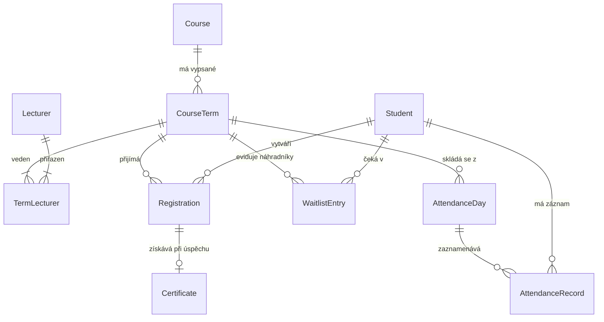

# Akademie Trutnov – Informační systém pro správu kurzů

Semestrální projekt pro předmět **Pokročilé programování (PPRO)**, FIM UHK (ZS 2026/2027).  
Zpracováno na základě oficiálního zadání: **Varianta C: Kurzy vzdělávacího centra**.

---

## 1. Kontext a výchozí situace

### 1.1 Klient
* **Organizace:** Akademie Trutnov
* **Kontaktní osoba:** Ing. Lucie Bartošová
* **Zaměření:** Rekvalifikační a firemní kurzy (přibližně 40 kurzů ročně).
* **Personální obsazení:** Všichni lektoři jsou externisté.

### 1.2 Výchozí stav (Jak to mají dnes)
* **Příjem přihlášek:** Přihlášky přicházejí z webového formuláře do e-mailu a asistentka je ručně přepisuje do Excel tabulky (jedna záložka pro každý kurz).
* **Hlídání kapacit:** Kapacita se kontroluje pouze vizuálně („okem“). Pořadník náhradníků se vede jako ruční poznámka tužkou pod seznamem.
* **Certifikace a osvědčení:** Osvědčení se vypisují ručně v MS Wordu. Číslování se odvozuje odhadem podle toho, kolik jich v daném roce již bylo vystaveno (došlo již k situaci, kdy bylo stejné číslo vydáno dvakrát).
* **Krizové situace:** Při odřeknutí účastníka na poslední chvíli vzniká chaos – není zřejmé, koho z náhradníků kontaktovat dříve a kdo má přednost.

---

## 2. Analýza požadavků

Dokument zadání člení požadavky do čtyř kategorií podle jejich závaznosti a dopadu na architekturu:

### 2.1 Funkční požadavky (Co klient chce – musí být implementováno)
1. **Správa kurzů:**
   * Evidence základních údajů kurzu: název, textová anotace, celkový rozsah v hodinách, cena, příznak akreditace (`ano`/`ne`).
2. **Termíny kurzů:**
   * Kurz se může opakovat několikrát do roka v různých termínech.
   * Termín má datum a čas začátku (`od`) a konce (`do`), místo konání (učebna/adresa) a maximální kapacitu.
   * Kapacita se u stejného kurzu může lišit podle přidělené učebny.
3. **Lektoři a jejich přiřazení:**
   * Evidence externích lektorů.
   * Jeden lektor může vést více různých termínů.
   * U delších kurzů se na jednom termínu střídají dva lektoři.
4. **Přihlášky studentů na termíny:**
   * Evidence studentů/účastníků.
   * Vztah M:N: jeden student se může účastnit více kurzů, na jednom termínu je zapsáno více studentů.
5. **Kapacita a pořadník náhradníků:**
   * Pokud je termín naplněn, další přihlášený zájemce je zařazen do pořadníku s přesným časovým razítkem / pořadovým číslem.
   * Při uvolnění místa musí systém přesně vědět a indikovat, kdo je na řadě.
6. **Evidence docházky:**
   * U vícedenních termínů se eviduje denní docházka jednotlivých účastníků (kdo byl který den přítomen).
7. **Dokončení kurzu a vydávání osvědčení:**
   * Na konci termínu se eviduje seznam úspěšných absolventů.
   * Generování osvědčení s unikátním evidenčním číslem a datem vydání. Číslo osvědčení se nesmí opakovat ani měnit po vydání.
8. **Přehledy a reporting:**
   * Přehled vytíženosti / naplněnosti jednotlivých termínů (v procentech i počtech).
   * Přehled odučených hodin pro jednotlivé lektory.
   * Přehled studentů, kteří se v daném roce přihlásili na více než jeden kurz.

---

### 2.2 Obchodní pravidla (Na čem klient trvá – systém vynutí bez výjimky)
* **Integrita kapacity:** Kapacitu termínu **nelze překročit** za žádných okolností (ani ručním zásahem).
* **Férovost pořadníku:** Pořadí zájemců v pořadníku se **nesmí přeskakovat**.
* **Auditovatelnost osvědčení:** Číslo osvědčení je přísně unikátní v celém systému a již vydané osvědčení je **neměnné** (imutabilní).
* **Historie přihlášek:** Zrušená přihláška se **nikdy fyzicky nemaže** z databáze; zůstává dohledatelná se stavem „zrušeno“ (důvod: řešení reklamací a stížností typu „já se přihlásil a vy jste mě smazali“).

---

### 2.3 Přání a výhled do budoucna (Co klient prohodil mimochodem)
* **Fakturační modul:** Aktuálně není požadována plná fakturace, ale architektura a doménový model musí počítat s budoucím napojením (např. vazba ceny přihlášky na fakturu/doklad).
* **Uživatelská přívětivost:** Rozhraní pro lektory (evidence docházky) musí být intuitivní, minimalistické a přehledné i pro technicky méně zdatné uživatele.
* **E-mailové notifikace:** Automatické odesílání e-mailů při změně stavu (potvrzení přihlášky, výzva pro náhradníka z pořadníku).
* **Exporty:** Výhledově export podkladů pro akreditační výkazy MŠMT.

---

### 2.4 Povinné technické minimum (Dle pravidel předmětu PPRO)
* **Architektura:** Striktně třívrstvá architektura se závislostmi orientovanými pouze jedním směrem (Prezentační -> Aplikační/Doménová -> Datová/Infrastrukturní).
* **Databáze:** Relační databáze (např. PostgreSQL) běžící v kontejneru přes Docker Compose.
* **Migrace:** Verzované databázové migrace řízené kódem.
* **Doménový model:** Minimálně 5 doménových entit a alespoň jedna vazba M:N.
* **Testování:** Sada integračních a jednotkových testů ověřujících obchodní pravidla.
* **Deployment & běh:** Celý projekt musí být reprodukovatelně spustitelný jediným příkazem:
  ```bash
  docker compose up
  ```
* **Bezpečnost dat:** Veškerá data v repozitáři jsou syntetická (žádná reálná osobní data, žádné reálné kontakty, žádné API klíče či přístupová hesla).
* **Kritické místo návrhu (Kde se návrh láme):** Algoritmus a stavový automat **pořadníku náhradníků** a striktní pravidlo pro **dokončení kurzu a vydání osvědčení**.

---

## 3. Předběžný doménový model

Na základě funkčních požadavků systém definuje následující klíčové entity a vztahy:

| Entita | Popis | Klíčové atributy |
| :--- | :--- | :--- |
| **`Course`** | Definice kurzu | `id`, `name`, `annotation`, `hours`, `price`, `is_accredited` |
| **`CourseTerm`** | Konkrétní běh/termín kurzu | `id`, `course_id`, `start_datetime`, `end_datetime`, `location`, `capacity` |
| **`Lecturer`** | Externí lektor | `id`, `first_name`, `last_name`, `email`, `phone`, `bio` |
| **`TermLecturer`** (M:N) | Přiřazení lektorů k termínu | `term_id`, `lecturer_id`, `role`, `allocated_hours` |
| **`Student`** | Účastník / student | `id`, `first_name`, `last_name`, `email`, `phone`, `created_at` |
| **`Registration`** | Přihláška studenta na termín | `id`, `term_id`, `student_id`, `status` (*CONFIRMED*, *CANCELLED*, *WAITLIST*), `registered_at` |
| **`WaitlistEntry`** | Záznam v pořadníku náhradníků | `id`, `term_id`, `student_id`, `position`, `status` (*WAITING*, *OFFERED*, *EXPIRED*, *ACCEPTED*), `created_at` |
| **`AttendanceDay`** | Kalendářní výukový den termínu | `id`, `term_id`, `date`, `topic` |
| **`AttendanceRecord`** | Účast studenta v daný den | `id`, `attendance_day_id`, `student_id`, `is_present`, `note` |
| **`Certificate`** | Vydané osvědčení o absolvování | `id`, `registration_id`, `certificate_number` (unikátní), `issue_date` |



---

## 4. Sekce Rozhodnutí (Architektonický a procesní deník)

> Tato sekce slouží jako oficiální protokol architektonických a procesních rozhodnutí k otevřeným bodům ze zadání klienta i průběžným dohodám. Zápisy jsou stručné, jednoznačné a uvádějí důvod volby.

### 4.1 Otevřené body ze zadání klienta

#### Rozhodnutí č. 1: Kdo rozhoduje o dokončení kurzu a vydání osvědčení
* **Formulace problému:** Klient váhá, zda je kritériem dokončení kurzu striktně 70% docházka, nebo subjektivní posouzení lektorem.
* **Rozhodnutí:** Pro možnost úspěšného dokončení kurzu je **povinnou systémovou podmínkou splnění minimálně 70 % evidované docházky**. Následně lektor (nebo administrátor) v systému provede finální potvrzení způsobilosti studenta a potvrdí vystavení osvědčení.
* **Odůvodnění:** Automatická kontrola docházky eliminuje neoprávněné vydání akreditovaného certifikátu neaktivním studentům, zatímco finální potvrzení lektorem zachovává odbornou garanci kvality výuky.

#### Rozhodnutí č. 2: Posun v pořadníku při uvolnění kapacity
* **Formulace problému:** Není ujasněno, zda se náhradník z pořadníku zapíše automaticky sám, nebo zda probíhá potvrzovací proces a jak řešit nezájem náhradníka.
* **Rozhodnutí:** Po uvolnění kapacity systém **automaticky osloví prvního náhradníka v pořadníku** a přepne jeho stav do `OFFERED` s časovým oknem na potvrzení (např. 24 hodin). Pokud náhradník účast potvrdí, přihláška se stane platnou (`CONFIRMED`); pokud lhůta vyprší nebo zájemce odmítne (`REJECTED`), systém nabídne místo dalšímu v pořadí.
* **Odůvodnění:** Automatické zapsání bez vědomí studenta by vedlo k neobsazeným místům a vymáhání plateb od lidí, kteří si mezitím zařídili jiný program. Manuální obvolávání by naopak neřešilo přetížení personálu.

#### Rozhodnutí č. 3: Zápis studenta na dva termíny téhož kurzu současně
* **Formulace problému:** Klient nespecifikoval, zda se student smí přihlásit na dva termíny stejného kurzu současně.
* **Rozhodnutí:** Student **nemůže mít dvě aktivní potvrzené přihlášky (`CONFIRMED`) na tentýž kurz současně**. Je však povoleno mít jednu potvrzenou přihlášku a zároveň být evidován v pořadníku náhradníků na dřívější či alternativní termín (přičemž při akceptaci náhradního termínu původní rezervace zaniká).
* **Odůvodnění:** Zabraňuje se spekulativnímu blokování omezených kapacit učeben jedním účastníkem na úkor ostatních zájemců.

#### Rozhodnutí č. 4: Přihlašování studentů po zahájení termínu kurzu
* **Formulace problému:** Základní pravidlo zakazuje přihlášení po začátku, ale klient zmínil existenci individuálních výjimek.
* **Rozhodnutí:** Běžné uživatelské rozhraní **neumožňuje zápis po datu zahájení termínu**. Zápis po zahájení může provést výhradně administrátor/recepce formou explicitní výjimky, a to nejpozději do ukončení prvního výukového dne, za předpokladu volné kapacity a garance, že student i při zmeškání úvodní části stále může dosáhnout požadovaných 70 % docházky.
* **Odůvodnění:** Zachovává se disciplína systému, zamezí se svévolnému zápisu v průběhu kurzu, ale management centra neztrácí možnost flexibilně vyřešit ojedinělé klientské situace v souladu s akreditačními standardy.

#### Rozhodnutí č. 5: Střídání lektorů a rozpad odučených hodin
* **Formulace problému:** U delších kurzů se střídají dva lektoři, ale v reportech klient zmiňuje hodiny „na lektora termínu“, jako by byl jen jeden.
* **Rozhodnutí:** Datový model realizuje přiřazení lektorů k termínu vazební entitou `TermLecturer` s uvedením podílu či konkrétních výukových dnů/hodin. Ve výkazech se lektorovi započítávají **skutečně jemu přidělené odučené hodiny** (nikoliv plný počet hodin celého termínu oběma lektorům).
* **Odůvodnění:** Klient platí lektory na základě odučených hodin. Započtení plných hodin oběma lektorům by zkreslilo finanční a mzdové podklady pro externisty.

---

### 4.2 Průběžný protokol dalších rozhodnutí
*(Zde budou chronologicky doplňována další rozhodnutí vzniklá během vývoje nebo konzultací s klientem/vyučujícím.)*

| Datum | Oblast / Téma | Rozhodnutí a zdůvodnění | Stav |
| :--- | :--- | :--- | :--- |
| **05. 10. 2026** | **Inicializace projektu** | Založen Git repozitář, vybrána Varianta C (Akademie Trutnov), sepsána výchozí technická specifikace a definováno 5 základních architektonických rozhodnutí. | **Schváleno** |
